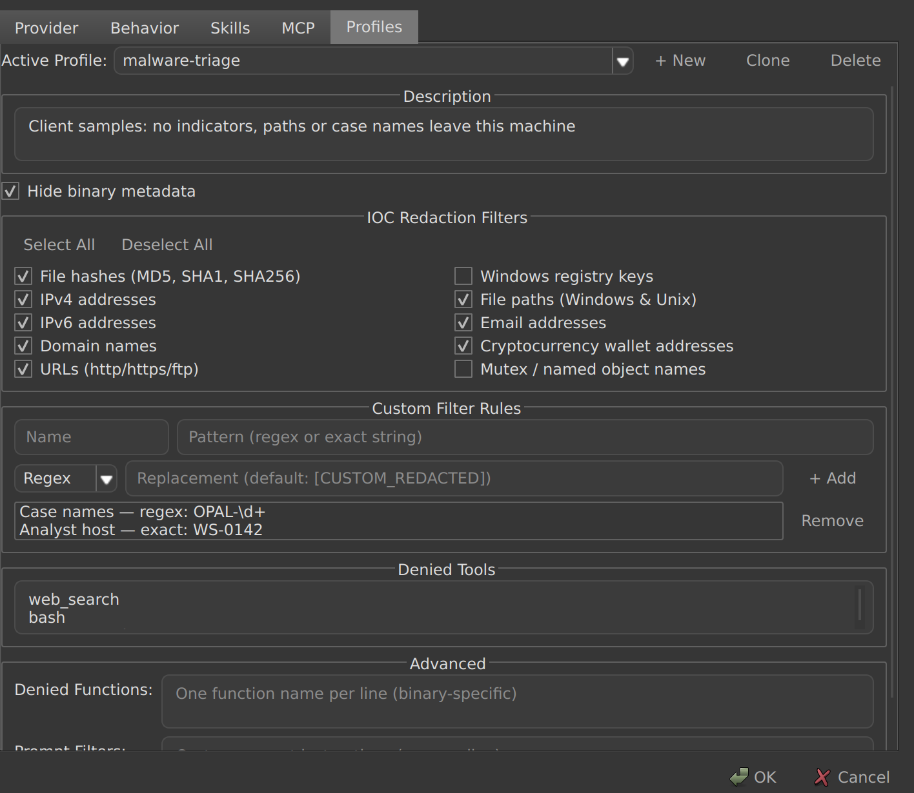

# Rikugan (六眼)

Rikugan is a reverse-engineering agent that lives inside IDA Pro and Binary Ninja. It is a native C++ plugin with its own reversing tools, prompts, modes, skills and chat panel, and since 2.0 its agent runs on [omc](https://github.com/buzzer-re/Oh-My-C). This project was vibecoded together with my friend, Claude Code.


[Documentation](https://rikugan.reversing.codes/docs.html) | [Architecture](https://rikugan.reversing.codes/ARCHITECTURE.html) | [Issues](https://github.com/buzzer-re/Rikugan/issues)

## Install

The installer downloads the latest release and puts the prebuilt plugin into every host it finds, IDA Pro, Binary Ninja or both. On Linux and macOS:

```bash
curl -fsSL https://raw.githubusercontent.com/buzzer-re/Rikugan/main/install.sh | bash
```

On Windows, in PowerShell:

```powershell
irm https://raw.githubusercontent.com/buzzer-re/Rikugan/main/install.ps1 | iex
```

Each package is checked against its published SHA-256 before it is unpacked. `--binja-only` and `--ida-only` limit the install to one host, and `--version X.Y.Z` installs a given release (`-Target` and `-Version` on Windows). If the host has a Rikugan 1.x (Python) install, the installer moves it to `~/.rikugan-1.x-backup/` first. Binary Ninja plugins are tied to its API version, so after a Binary Ninja update you need the matching Rikugan release, or a build of your own.

Once installed, Rikugan checks GitHub for a newer release once a day. When it finds one, the panel tells you, and nothing changes until you click Update. Rikugan then downloads the package for your host and platform, checks its SHA-256 and its version, and replaces the plugin, which the host loads at its next start. Settings → Behavior → Updates turns the daily check off, and its Check now button (or Ctrl+K → Check for updates) looks right away. Packages made with `build.sh` or `build.ps1` update the same way. A plugin built straight from CMake never does.

To build from source, `build.sh` (Linux and macOS) or `build.ps1` (Windows) makes the same packages in `dist/`, and `install.sh --from dist` (`install.ps1 -From dist`) installs them. [DEVELOPMENT.md](DEVELOPMENT.md) lists the toolchains.

```bash
git clone --recursive https://github.com/buzzer-re/Rikugan
git clone https://github.com/buzzer-re/Oh-My-C ohmyc     # omc, next to Rikugan
cd Rikugan && ./build.sh && ./install.sh --from dist
```

## Connecting a model

Open the panel (Ctrl+Shift+I in IDA, the Rikugan icon in Binary Ninja's sidebar) and follow Connect a model. You can sign in with a subscription you already pay for (Claude, ChatGPT/Codex, Gemini, GitHub Copilot and many more), paste an API key, or point Rikugan at a local server such as Ollama, LM Studio or llama.cpp. The model works right away, with no restart, and Ctrl+M switches the model and thinking level later. Settings → Provider also takes API keys, and its + button adds a custom connection to any OpenAI-compatible, Anthropic or Ollama endpoint.

If you already use the omc command-line agent, tick "Also use the logins of the omc command-line agent" and Rikugan shares its logins. Rikugan can also share a Claude Code or Codex CLI login ("Use my Claude Code / Codex login", or the checkbox in Settings → Provider) after you confirm. Using a subscription outside its own tool may be against the provider's terms.

## Is this another MCP client?

No. Rikugan is an agent built to live inside your disassembler. It does not reach the database through an MCP server: the agent runs inside the plugin with Rikugan's own role prompt ([source](prompts/system/base.md)) and works on the database through Rikugan's native tools, so there is no external client to switch to.

Each message runs a full agent loop. The answer streams as the model writes it, and the tools it calls run natively inside IDA or Binary Ninja, in parallel where that is safe. Retries and compaction happen on their own, the agent can stop to ask you a question, plan mode covers multi-step work, and you can queue messages while it runs. Rikugan is an assistant for your own analysis, and it does the whole job only when you ask it to. Press Ctrl+Shift+I and the chat is there.

## Features

Rikugan has more than 60 tools for navigation, the decompiler, disassembly, cross-references, strings, annotations, types and scripting, plus each host's own IL or microcode. It always asks before it runs a script and never runs the target binary. The [docs](https://rikugan.reversing.codes/docs.html) list every tool.

### Exploration

Rikugan explores a binary the way coding agents explore a codebase. The orchestrator maps the binary first (imports, exports, strings and the functions that matter), then spawns isolated subagents that analyze it in parallel. Each one reports back, and the orchestrator puts their findings together.

||
|:--:|
|Three subagents map the config, the C2 protocol and the persistence in parallel, followed live in the agents panel (Ctrl+J)|

### Natural-language patches (experimental)

With `/modify` you describe the change you want in plain English. Rikugan explores the binary for context and applies the patches, then asks whether to keep them.

||
|:--:|
|`/modify make this maze game easy, let me pass through walls`|

### Deobfuscation (experimental, Binary Ninja)

The `/deobfuscation` skill starts plan mode and uses Binary Ninja's IL read and write primitives to recognize and remove control-flow flattening, opaque predicates, MBA expressions and junk code.

||
|:--:|
|~3x speed of the workflow, original process took ~4:30 min|

### Goals

`/goal <objective>` keeps Rikugan working on its own, turn after turn, until it has checked that the objective is met. An objective can be to recover a struct and type every function that uses it, or to name a whole subsystem. The panel shows the goal and the time spent on it, with Pause and Clear. Database changes still ask first unless you allowed them for the chat, and in IDA the decompiler redraws as each change lands.

### Files, the shell and the web

The agent can read, write and edit files, search them, run shell commands, search the web and keep a todo list, so a session can end with scripts, notes and patches next to the annotations. It works in a scratch folder per database and can reach the binary's folder by path. Each kind of access (reading, writing, editing, the shell) asks the first time in a chat, and you can allow it once, allow it for the chat and its subagents, or deny it. Settings can allow files or shell commands without asking. `/undo` reverts database changes but not file changes, and none of these tools run in a sandbox. A hostile sample can try to steer any agent through prompt injection, so think twice before you allow the shell for a sample you don't trust.

### The panel

Every turn shows as a timeline of the model's thinking, its tool calls, subagents with their live progress, and permission and plan cards. Click an address or a symbol to jump there, and undo a database change from its own row. The strip above the timeline shows what Rikugan is doing, its todo list and the goal it works toward. Ctrl+K opens every command, Ctrl+M the model and thinking level, and Ctrl+J the agents, which you can steer or stop. Chats are named after their first exchange, and the colours follow the host's light or dark theme. You can paste or drop images into the message box.

The expand button in the panel's header (in Binary Ninja, also Plugins → Rikugan → Open in Full Window) turns Rikugan into a full-window view, with the chat in a tab beside the disassembly and the chats of every open database listed at its right. The same button puts it back. In Binary Ninja, the sidebar's Open in pane puts the panel beside the disassembly.

### Several databases (Binary Ninja)

Ask Rikugan to open another file and it opens it in a new tab once you agree. A subagent can then work on that tab, or on any other open one, to compare two builds or to look something up in a library. In the full-window view the chat list shows the chats of every tab, so you can move between them.

### Memory

Rikugan saves its findings to `RIKUGAN.md` next to your database, and the next session starts from them.

### Skills and MCP

Rikugan ships with 12 skills, and you can add your own in `~/.rikugan/omc/agent/skills/`. Settings → MCP adds MCP servers. In Binary Ninja, Rikugan can also use Binary Ninja's own MCP server (Plugins → MCP → Start Server). It looks for the server whenever a database shows, so it finds one you start later, and Settings → MCP → Address points it at another address. When the server answers, the panel offers its tools, and the MCP button in the header turns them on and off. While they are on, they take the place of Rikugan's analysis tools for that database, and `/undo` cannot revert their changes. omc's session commands work here too, among them `/btw` for a side question while a turn runs, `/compact`, `/handoff`, `/retry` and `/export`.

### Profiles

Profiles let you shape the agent around your analysis. A profile decides which data the model can read and which tools it can use, including omc's own such as `bash` or `web_search`, and you can write your own rules to filter data. Its IOC filters apply to every tool result the model sees, whether it comes from an analysis tool, a file, the shell, web search or an MCP server. A profile you switch in Settings applies to open chats at once, and a chat in the middle of a run takes it when the run ends.



## Recommended providers

| Provider | Notes |
|----------|-------|
| Claude Opus 4.6 | Best overall. Recommend Claude Pro/Max plan with OAuth over API. |
| Claude Sonnet 4.6 | Strong at lower cost. Both Anthropic models use prompt caching. |
| MiniMax M2.5 / Highspeed | On par with Opus in local tests. Generous limits, low cost. |
| Gemini 2.5 / 3 / 3.1 Pro | Solid results. Hallucinates more than Anthropic/MiniMax. |
| Kimi 2.5 | Strong coding, but lacks rigor for complex RE tasks. |
| LLAMA 70B / GPT 120B OSS | Interesting but not production-ready for RE. |

Rikugan also works with any OpenAI-compatible endpoint and with local servers.

## Requirements

Rikugan needs IDA Pro 9.3 (with Hex-Rays for the decompiler tools) or Binary Ninja in UI mode, and at least one model: an account login, an API key or a local server. It runs on Linux x86_64 with glibc 2.35 or later (Ubuntu 22.04, Debian 12, Fedora 36 and newer), Linux arm64 with glibc 2.39 or later (Ubuntu 24.04, Debian 13, Fedora 40 and newer), macOS on Apple silicon or Intel, and Windows 10 and 11 x64. On Windows the shell tool uses Git Bash when Git for Windows is installed, and PowerShell otherwise.

CI builds and tests every release on all five platforms. Each package comes with a `-symbols` package for reading crash logs, which Rikugan writes to `~/.rikugan/logs/`.

## What changed in 2.0

Rikugan 2.0 is a native rewrite for IDA Pro and Binary Ninja on Linux, macOS and Windows, with omc as its new backend, and it updates itself from the GitHub releases. Some things went away with the Python version: Rikugan's own provider layer (omc covers far more providers and logins), encrypted API keys (credentials now sit in Rikugan's settings folder, readable only by you on Linux and macOS), importing Claude Code and Codex skills and MCP servers, the research-note reviewer chain, resuming a cancelled mode, the `allowed_tools` skill setting and undoing file writes. Chats and settings from 1.x are not migrated. The [release notes](docs/releases/v2.0.0.md) list everything that is new.

## Conclusion

If you'd asked me last year what I thought about AI doing reverse engineering, I'd probably have said something like "Nah, impossible — it hallucinates, and reverse engineering is not something as simple as writing code." But this year I completely changed my mind when I saw what was achievable. AI is not the ChatGPT from 2023 anymore; it's something entirely different.

For that reason, I decided to invest this year in researching this topic. It's amazing what we can build with agentic coding — it's surreal how quickly I'm learning topics that I simply "didn't have time" to study before.

Rikugan is just one of many projects I've built in the last three months. The first version was built in a single night. Within two days it already supported both IDA and Binary Ninja. Within three days, it was essentially what you see here, with only minor tweaks since.

This is a work in progress with many areas for improvement. I took care to ensure this wouldn't be another AI slop project, but I'm certain there is still room to grow. I hope you use it for good. If you find bugs, have suggestions, or want quality-of-life improvements, please open an issue.

That's all — thanks.
